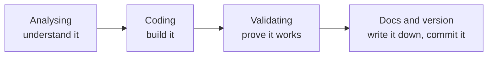

# Building Each Layer: The Workflow

Every layer of a medallion warehouse (bronze, silver, gold) is built the same way, in four stages. What changes from layer to layer is what each stage actually involves.



| Stage | Question it answers |
|---|---|
| **Analysing** | What am I working with, and what do I need to know before building? |
| **Coding** | What do I write to do this layer's job? |
| **Validating** | How do I know the result is right? |
| **Docs and version** | How will someone else (or future me) understand and reuse this? |

---

## The workflow per layer

| | Analysing | Coding | Validating | Docs and version |
|---|---|---|---|---|
| **Bronze** | Interview the source system experts | Data ingestion | Data completeness and schema checks | Document it, version it in Git |
| **Silver** | Explore and understand the data | Data cleansing | Data correctness checks | Document it, version it in Git. Add the data flow and data integration diagrams |
| **Gold** | Explore and understand the business objects | Data integration | Data integration checks | Document it, version it in Git. Add the data model, data catalog and data flow |

---

## Bronze

### Analysing: interview the source system experts

You can't load data well without knowing where it comes from. Before writing any code, talk to the people who know the source. The questions fall into three groups.

**Business context and ownership**
- Who owns the data?
- What business process does it support?
- Is there system and data documentation?
- Is there a data model or data catalog?

**Architecture and technology stack**
- How is the data stored (SQL Server, Oracle, AWS, Azure, ...)?
- What integration options exist (API, Kafka, file extract, direct database access, ...)?

**Extract and load**
- Incremental or full loads?
- What data scope and historical needs are there?
- How big are the expected extracts?
- Are there data volume limitations?
- How do I avoid hurting the source system's performance?
- What authentication and authorisation is needed (tokens, SSH keys, VPN, IP whitelisting, ...)?

The answers decide the load method, the schedule and the connection details. If nobody can answer them, write that down too, because it's a risk.

### Coding: data ingestion

Get the raw data into the bronze tables exactly as it arrives, with no changes. Typical pieces are the `CREATE TABLE` scripts (same columns as the source), a load such as `BULK INSERT`, and a stored procedure that runs them all with timing and error handling.

### Validating: completeness and schema checks

Bronze isn't cleaned, so validation here asks "did everything arrive, in the right shape?"
- **Completeness:** compare row counts with the source files (minus headers). Make sure no table loaded empty.
- **Schema:** check that the columns are in the right order and that values didn't shift into neighbouring columns.

```sql
SELECT COUNT(*) FROM bronze.some_table;
SELECT TOP 10 * FROM bronze.some_table;
```

### Docs and version

Document what was loaded, from where, and how often. Commit the scripts to Git.

---

## Silver

### Analysing: explore and understand the data

Before cleaning, look at the data and find out what's wrong with it. Run `SELECT *` and `SELECT DISTINCT` on code columns, then check each column for the usual problems: duplicates, NULLs, stray spaces, odd codes, impossible dates, and values that break business rules. Also work out how the tables relate to each other, so you know which keys will join later. Write down what you find, because it becomes the list of fixes.

### Coding: data cleansing

Write the transformations that fix those problems (trimming, de-duplication, standardising, defaults, casting, derived columns) and load them with a full load, truncate and insert.

### Validating: data correctness checks

Rerun the checks from the analysing stage, this time on the silver tables. Each should return no rows. Also compare silver row counts with bronze, and make sure the cleaned values are in range and follow the business rules.

### Docs and version

Document each fix and the reason for it, especially business decisions such as which default to use. Add two diagrams:
- **Data flow:** how data moves from source to bronze to silver.
- **Data integration:** how the tables relate to each other (which keys join).

Commit it all to Git.

---

## Gold

### Analysing: explore and understand the business objects

Gold is built around what the business cares about: customers, products, sales. Work out what those objects are, which silver tables feed each one, which source is the master when two disagree, and what the reports will need to ask.

### Coding: data integration

Combine the cleaned tables into business-ready objects. That means joining the sources, resolving conflicts between them, building surrogate keys, and shaping the result as a star schema (fact and dimension views).

### Validating: data integration checks

Check that the integration didn't break anything:
- **No duplicates introduced** by the joins (a join that fans out multiplies rows).
- **Row counts make sense** (the fact table has as many rows as its source).
- **Keys connect:** every fact row finds its dimension rows.
- **Values agree** when two sources describe the same thing.

```sql
-- the fact table should have one row per source row
SELECT COUNT(*) FROM gold.fact_sales;
SELECT COUNT(*) FROM silver.crm_sales_details;
```

### Docs and version

Gold is what other people actually use, so this needs the most documentation:
- **Data model:** how the objects connect.
- **Data catalog:** what every table and column means.
- **Data flow:** the full lineage from source to gold.

Commit it to Git.

---

## Reference: the layers side by side

| | Bronze | Silver | Gold |
|---|---|---|---|
| Definition | Raw, unprocessed data, as-is from sources | Clean and standardised data | Business-ready data |
| Objective | Traceability and debugging | Intermediate layer: prepare data for analysis | Provide data for reporting and analytics |
| Object type | Tables | Tables | Views |
| Load method | Full load (truncate and insert) | Full load (truncate and insert) | None |
| Transformation | None (as-is) | Cleaning, standardisation, normalisation, derived columns, enrichment | Integration, aggregation, business logic and rules |
| Data modelling | None (as-is) | None (as-is) | Star schema, aggregated objects, flat tables |
| Audience | Data engineers | Data analysts, data engineers | Data analysts, business users |

---

## Takeaways

- Don't start coding until you've done the analysing. The source interview for bronze and the data exploration for silver stop you building the wrong thing.
- Validation is part of the build, not an afterthought. Each layer has its own kind of check: completeness for bronze, correctness for silver, integration for gold.
- Documentation grows as you go up the layers. Bronze needs a note, silver needs the data flow and integration diagrams, and gold needs the full model, catalog and flow, because gold is what people outside the team read.
- Keep everything in Git. Scripts, documentation and diagrams all change, and version history is how you find out why.
